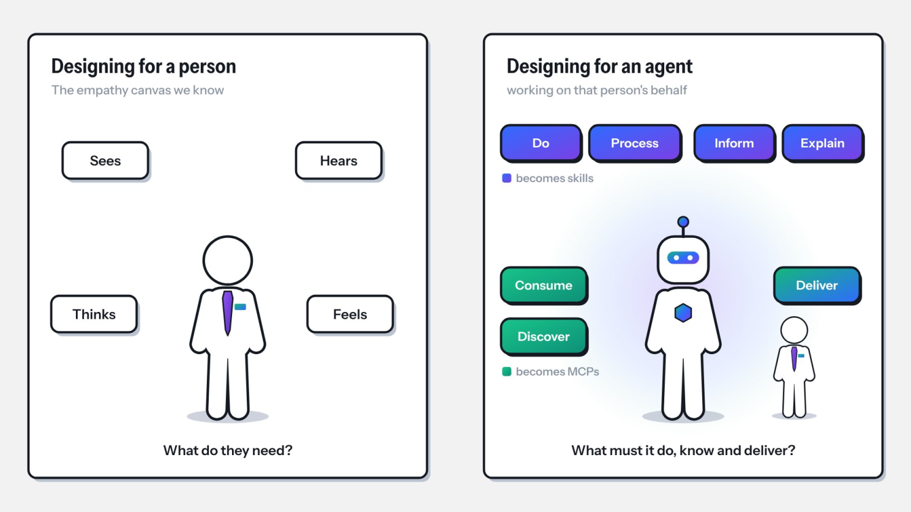
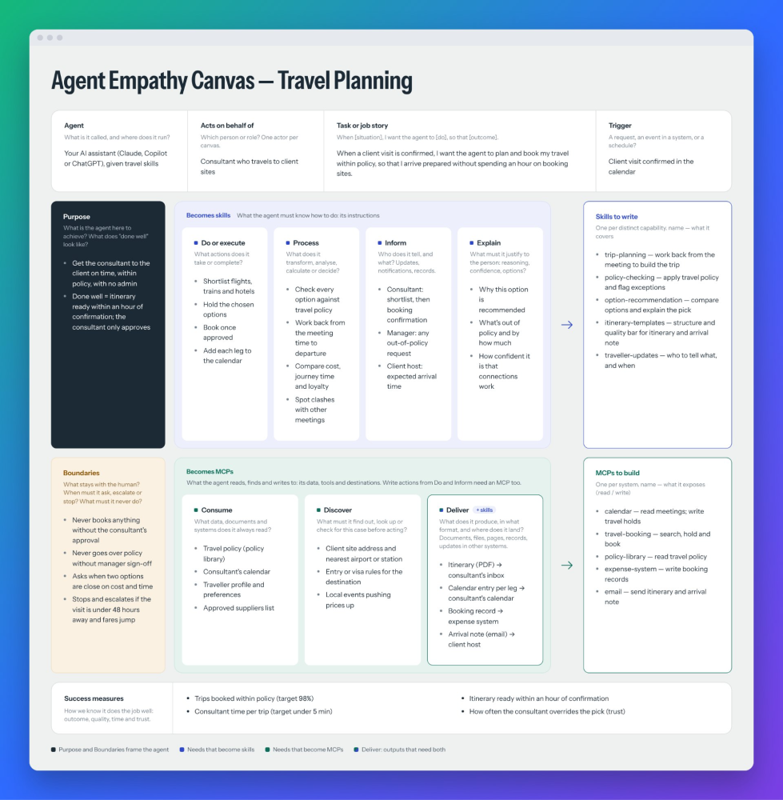
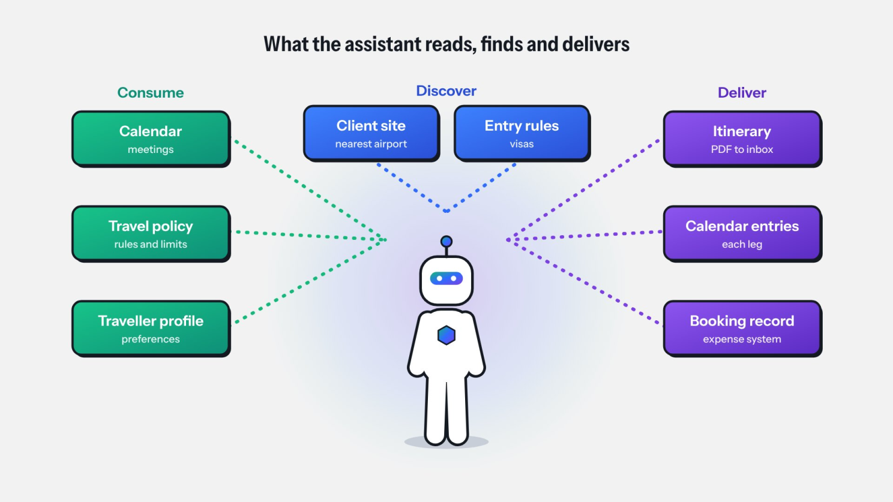
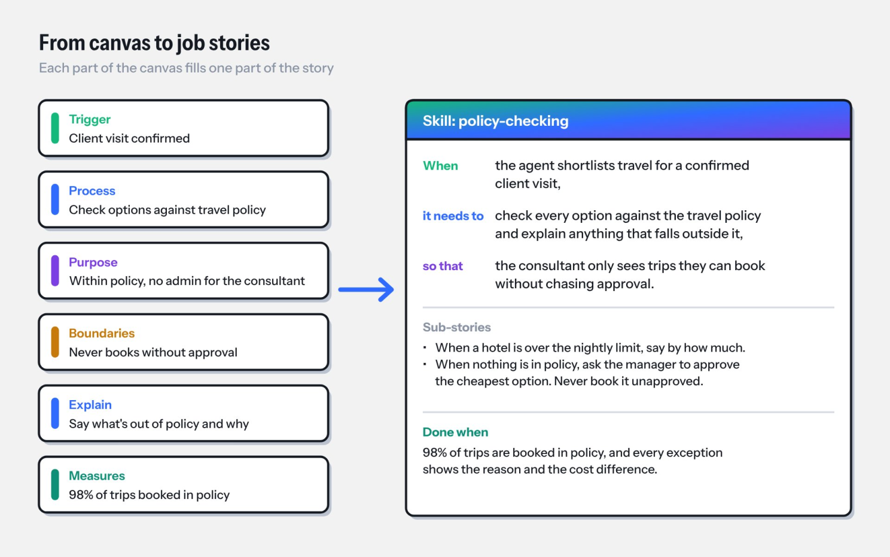
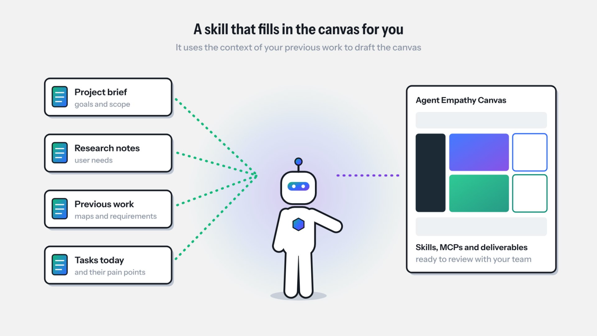

For most of my career, design started with a person. Who are they? What are they trying to get done? What gets in their way? We used tools like the empathy canvas to answer those questions: what the person sees, hears, thinks and feels, and what they need.

Over the past year, the question in the room has changed. Now it's "can AI do that for us?"

<!--more-->

## We're not building agents

Here's the thing many teams miss. Most of us don't need to build an agent. The agents already exist: Claude, Copilot, ChatGPT. They're capable and they're already on people's desktops.

What they don't have is our context. They don't know our processes, our rules, our systems, or what a good outcome looks like for the person they're helping. Out of the box, they're a brilliant new starter on their first day.

So the real job isn't "build an agent". It's to teach the agents we already have, by giving them two things:

- **Skills:** the instructions that tell the agent how to do a job well, including the rules, methods and templates, and what it must never do.
- **MCPs:** the connections that let it reach the right data and tools, and deliver its work in the right place.

Get those right, and the agent gets the person to the outcome they actually want. Get them wrong, and you get an impressive demo that falls apart in real work.

## Starting from the technology is the trap

Most teams write skills and connect systems based on what's available. Which systems can we hook up? What can we prompt it to do? Nobody stops to ask what the person on the other end needs, what the agent should never do, or what it should hand back at the end.

We've been here before. Teams made the same mistake with websites and apps before user-centred design became normal practice: build first, ask later.

## Designing for the agent, on behalf of the person

An agent acting on someone's behalf takes actions, reads data, makes judgements and hands over work. That makes it a participant in the experience, and like any participant, it has needs. If those needs aren't met, the person it serves is let down.

So I took the empathy canvas and turned it around. The persona in the middle is the agent. The person it works for stays in the frame, because everything the agent does is judged by whether that person ends up better off.

## The Agent Empathy Canvas

The canvas asks a simple set of questions, left to right.

**The frame**

- **Purpose:** what is the agent here to achieve for the person, and what does "done well" look like?
- **Boundaries:** what stays with the human? When must it ask, escalate or stop?

**What it must know how to do** (these become skills)

- **Do:** what actions does it take?
- **Process:** what does it analyse, calculate or decide?
- **Inform:** who does it tell, and what?
- **Explain:** what must it justify, such as its reasoning, its confidence or the options?

**What it must reach** (these become MCPs)

- **Consume:** what data and systems does it always read?
- **Discover:** what must it find out for this particular case?
- **Deliver:** what does it produce, in what format, and where does it land? A PDF in someone's inbox, a record in another system, a message in a channel.

It then brings everything together into three lists: the skills to write, the MCPs to build, and the success measures that tell you the agent is doing the job well.

Here's a made-up example: teaching an AI assistant to plan travel for a consultant who visits client sites. The consultant doesn't want an "AI travel tool". They want to arrive on time, within policy, without spending an hour on booking sites. That outcome shapes every skill and connection on the canvas.

## Name what the agent delivers

The step most teams skip is naming what the agent actually hands over. "It helps with travel" isn't something you can build. "An itinerary as a PDF in the consultant's inbox, a calendar entry for each leg, and a booking record in the expense system" is. If you can't name the output, the outcome isn't clear yet.

## From canvas to job stories

This is where the canvas earns its place. Each skill on the canvas becomes a job story your team can write, build and test, and each part of the canvas fills a part of the story:

- The trigger and process give you "When…"
- The do and explain items give you "it needs to…"
- The purpose gives you "so that…"
- The boundaries become the rules it must follow
- The success measures become "done when"

For the travel example, the policy-checking skill becomes:

> When the agent shortlists travel for a confirmed client visit, it needs to check every option against the travel policy and explain anything that falls outside it, so that the consultant only sees trips they can book without chasing approval.

With sub-stories:

- When a hotel is over the nightly limit, say by how much.
- When nothing is in policy, ask the manager to approve the cheapest option. Never book it unapproved.

Done when: 98% of trips are booked in policy, and every exception shows the reason and the cost difference.

That's a requirement a business owner can read and sign off, and a team can turn into a skill and test. It traces straight back to a real need, not to whatever a system happened to expose.

## Letting AI fill in the canvas

Filling in a canvas from scratch takes time, so I've also written a skill that lets the AI do the first draft. It plugs into the work you've already done: the brief, interview notes, the tasks people do today and the challenges they face. From that context it drafts the canvas, proposes the skills and MCPs, and names what should be delivered. Your job becomes reviewing and correcting that draft with the people who know the work, not starting from a blank page.

There's something fitting about that: a skill teaching the agent how to work out which skills it needs, with the person still at the centre.

## What I've learned so far

- Discover is not the same as Consume. Most missing connections hide in what the agent has to go and find out for each case.
- If the Explain box is empty, people won't trust the agent.
- Leadership reads the Boundaries first, so draw them deliberately.
- If the process owner can't read and sign off a skill, it's too vague or too technical.

The agents are already here. Our job is to teach them well, starting from the people they serve.

I'd like to hear how others are approaching this. When your team decides what to teach Claude, Copilot or ChatGPT, where do you start?
