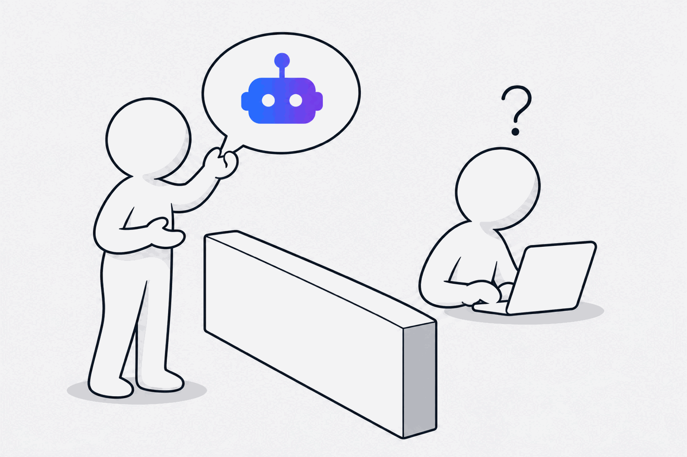

Most AI projects I see start the same way. Someone senior is asked "can AI do that?" and the answer, quite reasonably, is "let's find out". A team is pointed at it. A budget is found. And the request lands on the developers as a solution: "build us an agent that does X."

<!--more-->

Nobody is at fault. It's the obvious thing to do when the question comes every week. But it skips the only question that matters before money moves: is this the right thing to build at all?

## Where it goes wrong

When a request arrives as a solution, the people building it have two bad options. Build what was asked for and find out later it was the wrong thing. Or push back and ask the questions nobody asked, which feels like delay, and lands on your desk as "why is this taking so long?"

I've sat on your side of that table. The gap isn't technical. It's that nobody shaped the ask before it became a backlog, and by the time that's visible, the budget is committed.

## You don't need a discovery phase. You need a brief.

Discovery has a bad name with leaders, and I understand why. It sounds like weeks of interviews before anyone builds anything, and the project you've just backed is already moving.

So I've turned it into an hour. The person who asked for the AI sits down with an agent in whatever tool they already use: Copilot, ChatGPT or Claude. It asks fifteen questions, one at a time, keeps asking why until the answer is clear, and writes a one-page brief you can sign off. No workshop. No research team. Nobody learns a new tool.

The agent is a page of text. It's free, and it's at the bottom of this article.

## What it asks, and why it matters to you

The questions come from the [Agent Empathy Canvas](/writing/we-used-to-design-for-humans/) I wrote about last time, reframed for the person who signs the budget. Four of them are the ones you'd ask yourself.

**What is it for?** If your expert can't say it in one sentence, nothing downstream will be clear. This is the line you judge the whole project against.

**Why do you want it?** The first answer is usually the symptom. Keep asking and you reach the thing that actually needs fixing, which is sometimes not an AI thing at all.

**What must it never do?** What stays with a person, and what is it allowed to do on its own? This is where your risk is decided, deliberately rather than by accident. Read this part first.

**What happens when it gets something wrong?** Every agent meets a case it wasn't designed for. Cheaper to decide now than in production.

The other eleven are the ones your team needs answered before they can build: what it does, what it works out, what it tells people and must explain, what systems it reads from and writes to, what it hands over and where, what would make people hate it, and how you'll know it's working. The agent asks those too. You don't have to.

## What came back: a worked example

Here's a made-up request of the kind that lands every week.

**The ask:** "We need an AI agent that can answer questions about our supplier contracts. Legal is drowning in the same questions."

**What the hour found:** Legal gets forty emails a week. Why? People need the payment terms, the notice period or the renewal date before they can act. Why can't they look it up? Those three details are inside PDFs; the contract system only holds the file and the signing dates. Why? Nobody owns that data. It was never anyone's job.

Asked whether they'd still want the agent if those three fields were in the system and searchable: "Honestly, that would solve most of it."

**The brief's recommendation:** Fix the underlying problem first, then build a narrower version. Get the three fields into the system (an agent can do the first pass, a person checks it). Then give people a small agent that answers those three questions with a link to the clause. Do not build a general "ask anything about contracts" agent: it would answer complex clauses with confidence it hasn't earned, and legal would still have to check everything.

That's a different project from the one that was asked for. Smaller, cheaper, and it fixes the thing that was actually broken. The full brief is on the [tool page](/tools/ai-brief-builder/).

## What you get

One page: the line it's for, the real problem, a recommendation (build it, build it narrower, fix something else first, or don't), what it does, what it touches, the rules, what happens when it fails, and job stories your team can build and test from.

A brief you can sign off and your team can build from. It traces back to a real need, not a demo someone saw.

## Get the tool

**[Download the AI Brief Builder](/tools/ai-brief-builder/)** — a zip with the agent as a Claude skill, as instructions for a Copilot agent or a custom GPT, and the worked example. Give it to the person who asked for the AI, not to the developers. An hour later you'll have the brief.

Some of those briefs will come back saying the problem doesn't need an agent. That's not the process failing. That's the cheapest no you'll get all year.

So before you fund the next one, ask for the brief.
