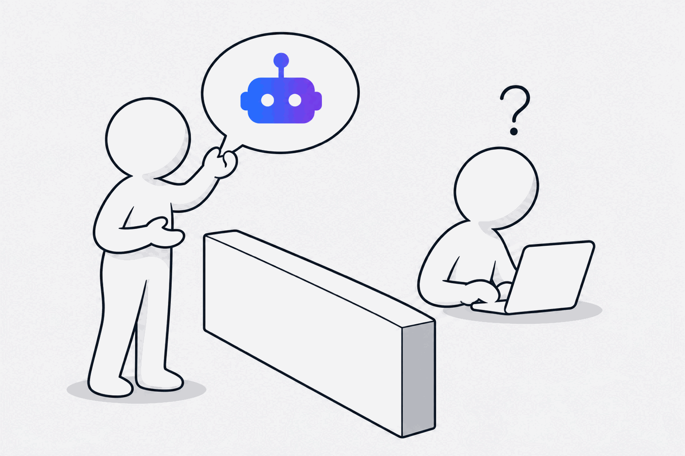
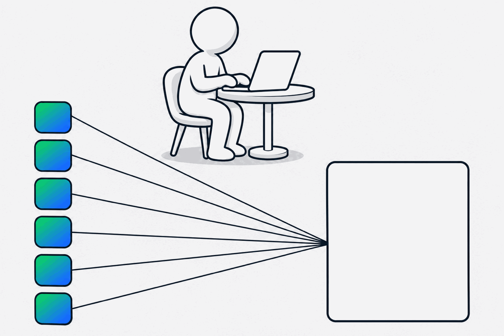

Most AI requests I see arrive the same way. A business team has decided what they want built. "We need an agent that does X." It lands on the developers as a solution, not a problem.

<!--more-->

That is not the team's fault. It is the obvious thing to do when everyone is being asked "can AI do that?" every week. But it skips the only question that matters: is this the right thing to build at all?

## Solutionising is the new brief

When a request comes in as a solution, the developers have two bad options. They can build what was asked for and find out later it was the wrong thing. Or they can push back and ask the questions the business team didn't, which takes time, feels like friction, and often lands as "why are you making this difficult?"

I have sat on both sides of that. The gap is not technical. It is that nobody has done the discovery, and the ask has gone straight from an idea to a backlog.

## Put discovery in front of the build, as an agent

The thing we are trying now is simple. Rather than developers chasing the questions after the request arrives, the subject matter expert answers them before it does. And the way they do that is with an agent.

Not a form. Not a workshop. An agent, in whatever tool the expert already uses: Copilot, ChatGPT or Claude. It asks the questions a good discovery lead would ask, keeps asking why until the answer is clear, and produces a brief the developers can actually work from.

It plugs in with the way people already work. Nobody has to learn a new tool or book time with the design team to get started.

## What the agent asks, and why

The questions come straight from the [Agent Empathy Canvas](/writing/we-used-to-design-for-humans/) I wrote about last time. Each one has a reason, and each one adds something the developers would otherwise have to guess.

**What is the purpose and role of the agent?** Why: this is the "so that" of everything else. If the expert cannot say what the agent is for in one sentence, nothing downstream will be clear either. Adds: the outcome the brief is judged against.

**What outcomes does it need to deliver, and why?** Why: "why" is where the real problem lives. The first answer is usually the symptom; the agent keeps probing until it reaches the thing that actually needs fixing. Adds: a problem statement, not a feature request.

**What does it have to do, and what does it have to process?** Why: these become the skills. Actions on one side, analysis and judgement on the other. Adds: the list of skills to write.

**What does it inform people about, and what does it have to explain?** Why: if the agent cannot explain its reasoning or its confidence, people will not trust it. Adds: the trust and transparency requirements, which are usually forgotten until go-live.

**What does it consume, what does it discover, and what does it deliver, where?** Why: these become the MCPs, the connections to data and tools. "It helps with contracts" is not buildable; "a summary as a PDF in the reviewer's inbox and a record in the contract system" is. Adds: the data sources, the integrations and the artefacts.

**What should it not do? What stays in human control, and what is it allowed to automate?** Why: leadership reads the boundaries first. This is also where risk is decided, deliberately rather than by accident. Adds: the rules and permissions.

**What should it be watching for, and what happens when something goes wrong?** Why: every agent meets a case it was not designed for. Deciding now what it observes, reacts to and escalates is cheaper than finding out in production. Adds: the failure states.

**What would cause friction between you and the agent? What would be a pain?** Why: the expert knows where this will annoy people long before anyone else does. Adds: the experience requirements, which are the difference between an agent people use and one they route around.

**And the plain one: why are you asking for this?** Why: because sometimes the honest answer is "because we were told to look at AI", and that is worth knowing before the budget goes.

## What comes out the other end

A brief the developers can analyse, in a form they recognise.

- Job stories: when, it needs to, so that, done when.
- The data sources and the MCPs that reach them.
- The skill areas and the outcomes each one is responsible for.
- The boundaries: what it does, what it does not do, what stays with a person.
- The failure states and what happens in each.

That is a request a process owner can sign off and an engineering team can build and test. It traces back to a real need rather than to whatever someone saw in a demo.

## What changes

The developers stop being the people who have to ask the awkward questions. The expert has already answered them, in their own words, in a tool they already use. And the business team gets something they did not have before: a clear view of whether this is worth building at all, before anyone has written a line of code.

Some of those briefs will come back saying the problem does not need an agent. That is not a failure of the process. That is the process working.
